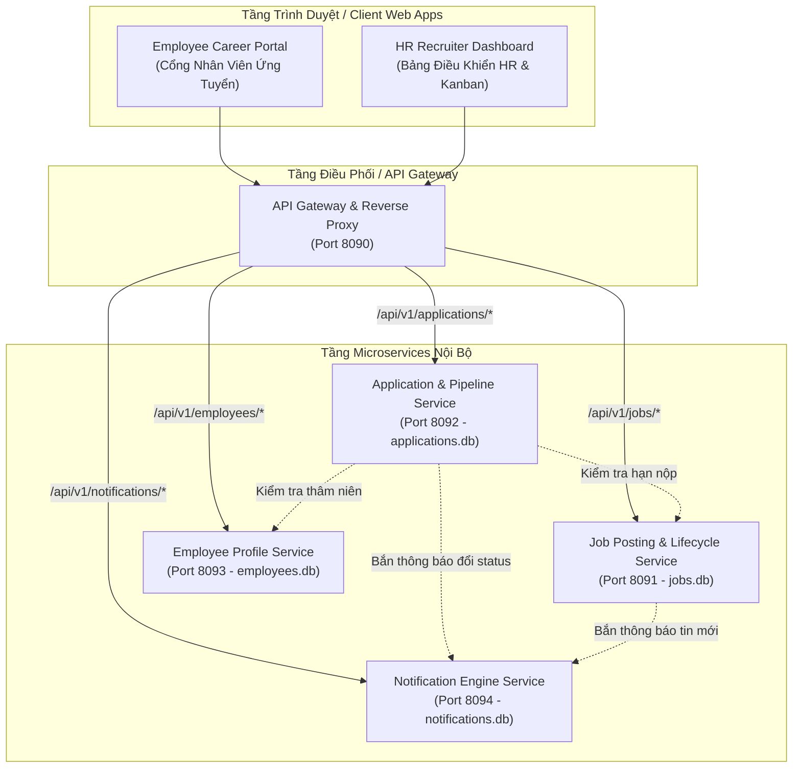
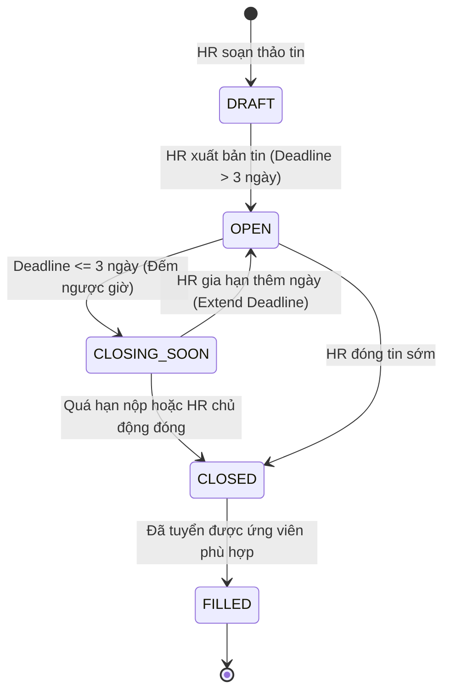
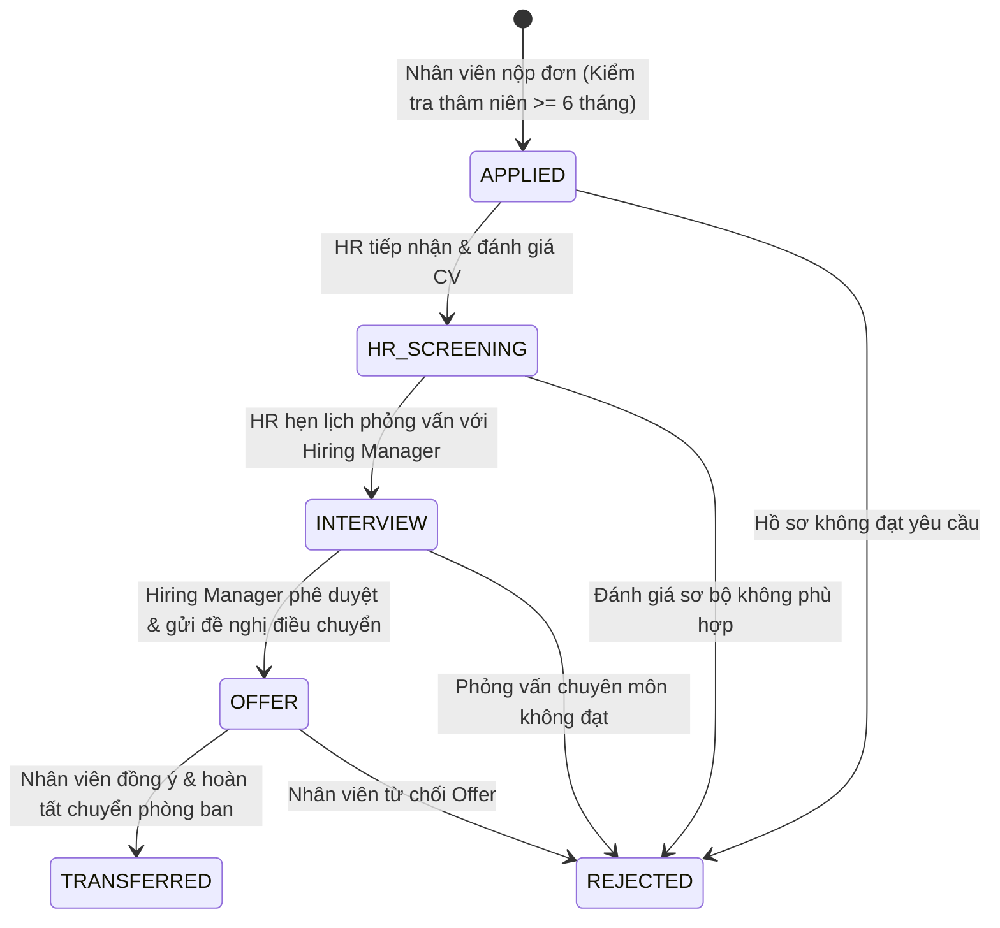

# ĐẶC TẢ YÊU CẦU PHẦN MỀM (SRS)
## SOFTWARE REQUIREMENTS SPECIFICATION (SRS)

**Dự án:** Cổng Tuyển Dụng & Điều Chuyển Nhân Tài Nội Bộ Doanh Nghiệp (Internal Recruitment & Talent Mobility Platform - IRTMP)  
**Tiêu chuẩn tài liệu:** Tuân thủ chuẩn IEEE 830 / ISO/IEC/IEEE 29148  
**Phiên bản:** 1.0  
**Tác giả:** System Architect & Lead Software Engineer  
**Ngày ban hành:** 18/09/2026  
**Trạng thái:** Bản thảo kỹ thuật chính thức (Official Baseline)  

---

## MỤC LỤC
1. [Giới thiệu (Introduction)](#1-giới-thiệu-introduction)
2. [Mô tả tổng quan hệ thống (Overall Description)](#2-mô-tả-tổng-quan-hệ-thống-overall-description)
3. [Kiến trúc hệ thống & Luồng dữ liệu kỹ thuật (System Architecture & Data Flows)](#3-kiến-trúc-hệ-thống--luồng-dữ-liệu-kỹ-thuật-system-architecture--data-flows)
4. [Đặc tả yêu cầu chức năng chi tiết (Detailed Functional Requirements)](#4-đặc-tả-yêu-cầu-chức-năng-chi-tiết-detailed-functional-requirements)
5. [Yêu cầu giao diện ngoại vi (External Interface Requirements)](#5-yêu-cầu-giao-diện-ngoại-vi-external-interface-requirements)
6. [Yêu cầu phi chức năng (Non-Functional Requirements - NFRs)](#6-yêu-cầu-phi-chức-năng-non-functional-requirements---nfrs)
7. [Mô hình dữ liệu kỹ thuật (Data Models & DDL Schemas)](#7-mô-hình-dữ-liệu-kỹ-thuật-data-models--ddl-schemas)
8. [Tiêu chí kiểm thử và nghiệm thu (Verification & Acceptance Criteria)](#8-tiêu-chí-kiểm-thử-và-nghiệm-thu-verification--acceptance-criteria)

---

## 1. Giới thiệu (Introduction)

### 1.1. Mục đích (Purpose)
Tài liệu này đặc tả chi tiết toàn bộ các yêu cầu chức năng, yêu cầu phi chức năng, kiến trúc kỹ thuật phân tán (Microservices Architecture), giao thức API và lược đồ cơ sở dữ liệu cho hệ thống **"Cổng Tuyển Dụng & Điều Chuyển Nhân Tài Nội Bộ Doanh Nghiệp" (IRTMP)**.

### 1.2. Phạm vi sản phẩm (Product Scope)
Hệ thống giải quyết dứt điểm các bất cập của quy trình tuyển dụng nội bộ qua email truyền thống bằng cách:
- Cung cấp cổng tra cứu việc làm tập trung với trạng thái real-time (`OPEN`, `CLOSING_SOON`, `CLOSED`, `FILLED`) kèm bộ đếm ngược hạn chót.
- Tính năng nộp hồ sơ 1 chạm bảo mật tuyệt đối với quản lý trực tiếp.
- Bảng Kanban quản trị quy trình tuyển dụng minh bạch cho HR và Hiring Manager.
- Động cơ thông báo tự động (Real-time Notification Engine) cập nhật tiến độ hồ sơ cho ứng viên.

### 1.3. Định nghĩa và Thuật ngữ (Definitions & Acronyms)
- **IRTMP:** Internal Recruitment & Talent Mobility Platform.
- **JD (Job Description):** Bản mô tả công việc chi tiết.
- **SSO (Single Sign-On):** Cơ chế đăng nhập một lần bằng tài khoản doanh nghiệp.
- **Kanban Pipeline:** Quy trình xử lý hồ sơ ứng viên trực quan theo các cột mốc.
- **Time Drift:** Độ sai lệch thời gian kiểm tra hạn chót nộp hồ sơ.

---

## 2. Mô tả tổng quan hệ thống (Overall Description)

### 2.1. Bối cảnh sản phẩm (Product Perspective)
Hệ thống IRTMP được xây dựng theo kiến trúc **Microservices chuẩn công nghiệp**, gồm 1 API Gateway và 4 Microservices độc lập theo mẫu thiết kế **Database-per-Service**:



### 2.2. Các lớp người dùng (User Classes & Characteristics)
1. **Nhân viên ứng tuyển (Internal Candidate):** Tìm kiếm vị trí thăng tiến/luân chuyển, nộp CV, theo dõi trạng thái hồ sơ của mình.
2. **Chuyên viên tuyển dụng (HR Recruiter):** Đăng tin JD mới, gia hạn/đóng tin, quản lý ứng viên trên bảng Kanban, kích hoạt lịch phỏng vấn và gửi Offer.
3. **Quản lý bộ phận tuyển (Hiring Manager):** Xem hồ sơ ứng viên đã qua vòng sàng lọc HR, chấm điểm phỏng vấn chuyên môn.
4. **Quản trị hệ thống (System Admin):** Cấu hình danh mục kỹ năng, phân quyền truy cập và giám sát sức khỏe cụm Microservices.

---

## 3. Kiến trúc hệ thống & Luồng dữ liệu kỹ thuật (System Architecture & Data Flows)

### 3.1. Luồng trạng thái Tin Tuyển Dụng (Job Posting Lifecycle FSM)



### 3.2. Luồng xử lý Hồ sơ Ứng tuyển dạng Kanban (Application Pipeline FSM)



---

## 4. Đặc tả yêu cầu chức năng chi tiết (Detailed Functional Requirements)

### 4.1. Module 1: Quản lý Tin Tuyển Dụng (FR-JOB)

| Mã Yêu Cầu | Tên chức năng | Đặc tả chi tiết | Mức ưu tiên |
|---|---|---|:---:|
| **FR-JOB-01** | Tạo mới tin tuyển dụng | HR nhập: Tiêu đề, Mã vị trí, Phòng ban tuyển, Cấp bậc, Mức lương/Phụ cấp tham chiếu, Hạn chót nộp hồ sơ (Deadline `YYYY-MM-DD`), Mô tả công việc (JD) và Danh sách kỹ năng yêu cầu. Hệ thống tự động đặt trạng thái ban đầu là `OPEN`. | **MUST** |
| **FR-JOB-02** | Tính toán trạng thái Real-time | Hệ thống tự động tính toán trạng thái dựa trên thời gian thực: Nếu thời gian còn lại $> 72$ giờ $\rightarrow$ `OPEN`; Nếu còn lại $\le 72$ giờ $\rightarrow$ `CLOSING_SOON` (hiển thị nhãn vàng kèm đếm ngược giờ/phút); Nếu $T_{current} > Deadline$ $\rightarrow$ `CLOSED`. | **MUST** |
| **FR-JOB-03** | Gia hạn tin tuyển dụng | Cho phép HR điều chỉnh ngày Deadline sang thời điểm tương lai. Hệ thống tự động cập nhật trạng thái từ `CLOSED` hoặc `CLOSING_SOON` trở lại `OPEN`. | **MUST** |
| **FR-JOB-04** | Đóng tin tuyển dụng chủ động | HR có thể bấm nút "Đóng tin" bất cứ lúc nào nếu vị trí đã tuyển đủ người mà không cần đợi đến ngày hết hạn. | **MUST** |
| **FR-JOB-05** | Tìm kiếm & Lọc đa tiêu chí | Cung cấp bộ lọc cho nhân viên theo: Từ khóa tiêu đề, Phòng ban (Engineering, Product, Marketing, Sales, v.v.), Cấp bậc (Junior, Mid, Senior, Lead), Kỹ năng và Chỉ hiển thị tin còn hạn. | **MUST** |

### 4.2. Module 2: Ứng Tuyển & Quản Lý Hồ Sơ (FR-APP)

| Mã Yêu Cầu | Tên chức năng | Đặc tả chi tiết | Mức ưu tiên |
|---|---|---|:---:|
| **FR-APP-01** | Nộp hồ sơ 1 chạm bảo mật | Nhân viên chọn vị trí muốn ứng tuyển, chọn "Sử dụng Profile nội bộ" hoặc tải lên file CV (PDF/DOCX, tối đa 5MB). Nhập thư nguyện vọng (Cover Letter, tối thiểu 10 ký tự, tối đa 1000 ký tự). | **MUST** |
| **FR-APP-02** | Kiểm tra Điều kiện Thâm niên | Khi nộp đơn, hệ thống gọi inter-service sang `Employee Service` kiểm tra: Thâm niên công tác tại vị trí hiện tại phải $\ge 6$ tháng (180 ngày). Nếu $< 180$ ngày $\rightarrow$ Bị từ chối với thông báo: *"Chưa đủ thâm niên tối thiểu 6 tháng tại vị trí hiện tại"*. | **MUST** |
| **FR-APP-03** | Giới hạn Đơn nộp Đồng thời | Mỗi nhân viên chỉ được có tối đa **3 đơn ứng tuyển đang hoạt động** (`APPLIED`, `HR_SCREENING`, `INTERVIEW`). Nếu cố nộp đơn thứ 4 $\rightarrow$ Từ chối với lỗi `MAX_ACTIVE_APPLICATIONS_REACHED`. | **MUST** |
| **FR-APP-04** | Theo dõi Tiến trình Pipeline | Nhân viên có màn hình "Hồ sơ của tôi" hiển thị thanh tiến trình 5 bước trực quan kèm ngày cập nhật và trạng thái phản hồi mới nhất. | **MUST** |

### 4.3. Module 3: Bảng Quản Trị Tuyển Dụng Kanban (FR-KAN)

| Mã Yêu Cầu | Tên chức năng | Đặc tả chi tiết | Mức ưu tiên |
|---|---|---|:---:|
| **FR-KAN-01** | Bảng điều khiển Kanban trực quan | Hiển thị ứng viên dưới dạng các Card trong 5 cột trạng thái: `APPLIED`, `HR_SCREENING`, `INTERVIEW`, `OFFER`, `TRANSFERRED` (và danh sách `REJECTED`). | **MUST** |
| **FR-KAN-02** | Chuyển đổi trạng thái linh hoạt | HR có thể bấm nút chuyển trạng thái ứng viên sang bước tiếp theo hoặc đánh dấu `REJECTED`. Hệ thống tự động ghi nhận thời gian và người thực hiện thay đổi. | **MUST** |
| **FR-KAN-03** | Chấm điểm & Đánh giá phỏng vấn | Cho phép nhập điểm phỏng vấn (1 đến 5 sao) kèm ghi chú nhận xét chuyên môn của Hiring Manager. | **SHOULD** |

### 4.4. Module 4: Hệ Thống Thông Báo Tự Động (FR-NOTI)

| Mã Yêu Cầu | Tên chức năng | Đặc tả chi tiết | Mức ưu tiên |
|---|---|---|:---:|
| **FR-NOTI-01** | Thông báo Biến động Trạng thái | Bất kỳ khi nào hồ sơ được HR chuyển trạng thái, hệ thống tự động sinh 1 bản ghi thông báo và gửi tức thì tới Cổng Nhân Viên trong vòng $\le 2$ giây. | **MUST** |
| **FR-NOTI-02** | Hộp thư Thông báo Cá nhân | Nhân viên có chuông thông báo (Notification Bell) hiển thị số lượng tin chưa đọc (Unread Count) và danh sách chi tiết các thông báo tuyển dụng. | **MUST** |

---

## 5. Yêu cầu giao diện ngoại vi (External Interface Requirements)

### 5.1. Giao diện người dùng (Dual-Portal Web UI)
- **Màn hình Trái (Cổng Nhân Viên - Employee Portal):**
  - Thanh tìm kiếm & bộ lọc phòng ban, cấp bậc.
  - Danh sách thẻ công việc (Job Cards) với Badge trạng thái màu sắc rõ ràng (`OPEN`: Xanh lá, `CLOSING_SOON`: Vàng cam, `CLOSED`: Đỏ xám).
  - Modal xem chi tiết JD và Form nộp hồ sơ 1 chạm.
  - Tab "Hồ sơ đã nộp" hiển thị Pipeline trực quan và Hộp thư thông báo.
- **Màn hình Phải (Bảng Điều Khiển HR - HR Recruiter Dashboard):**
  - Form đăng tin JD mới kèm chọn Deadline.
  - Bảng Kanban 5 cột quản lý toàn bộ ứng viên nội bộ.
  - Các nút hành động nhanh: Duyệt sơ bộ, Lên lịch phỏng vấn, Gửi Offer, Từ chối, Gia hạn tin.

### 5.2. Giao diện REST API chuẩn JSON

#### API 1: Tạo đơn ứng tuyển nội bộ
- **Endpoint:** `POST /api/v1/applications/apply`
- **Request Body:**
```json
{
  "job_id": "JOB-001",
  "employee_id": "EMP-1024",
  "use_profile": true,
  "cover_letter": "Tôi có 2 năm kinh nghiệm làm Python Backend và mong muốn thử sức tại vị trí Data Engineer...",
  "resume_filename": "CV_NguyenVanAn_Data.pdf"
}
```
- **Response Success (200 OK):**
```json
{
  "success": true,
  "application_id": "APP-20260918-0012",
  "status": "APPLIED",
  "submitted_at": "2026-09-18T14:00:00Z",
  "message": "Hồ sơ ứng tuyển đã được tiếp nhận an toàn và bảo mật!"
}
```

---

## 6. Yêu cầu phi chức năng (Non-Functional Requirements - NFRs)

### 6.1. Hiệu năng (Performance Requirements)
- **NFR-PERF-01:** Thời gian phản hồi API tìm kiếm và tải danh sách tin tuyển dụng $\le 300$ miligiây.
- **NFR-PERF-02:** Thao tác chuyển trạng thái ứng viên trên bảng Kanban phản hồi trên giao diện người dùng $\le 500$ miligiây.

### 6.2. An toàn & Bảo mật (Security Requirements)
- **NFR-SEC-01 (Bảo mật Ứng tuyển Nội bộ):** Thông tin ứng tuyển tuyệt đối không hiển thị cho Quản lý trực tiếp cũ cho đến khi ứng viên nhận Offer chính thức và đồng ý điều chuyển.
- **NFR-SEC-02 (Phân quyền RBAC):** Chỉ tài khoản có vai trò `HR_RECRUITER` hoặc `HIRING_MANAGER` mới có quyền truy cập Bảng điều khiển tuyển dụng và xem hồ sơ ứng viên.

### 6.3. Độ tin cậy & Tính sẵn sàng (Reliability & Availability)
- **NFR-REL-01:** Hệ thống cam kết SLA sẵn sàng đạt $\ge 99.9\%$.
- **NFR-REL-02 (Toàn vẹn dữ liệu):** Mọi thay đổi trạng thái hồ sơ ứng viên đều được ghi log kiểm toán (Audit Trail) để đối soát.

---

## 7. Mô hình dữ liệu kỹ thuật (Data Models & DDL Schemas)

### 7.1. Database Job Service (`jobs.db`)
```sql
CREATE TABLE IF NOT EXISTS jobs (
    job_id TEXT PRIMARY KEY,
    title TEXT NOT NULL,
    department TEXT NOT NULL,
    level TEXT NOT NULL,
    salary_range TEXT NOT NULL,
    location TEXT NOT NULL,
    description TEXT NOT NULL,
    required_skills TEXT NOT NULL,
    status TEXT DEFAULT 'OPEN',          -- 'OPEN', 'CLOSING_SOON', 'CLOSED', 'FILLED'
    deadline_date TEXT NOT NULL,         -- 'YYYY-MM-DD'
    created_at TIMESTAMP DEFAULT CURRENT_TIMESTAMP,
    updated_at TIMESTAMP DEFAULT CURRENT_TIMESTAMP
);
```

### 7.2. Database Application Service (`applications.db`)
```sql
CREATE TABLE IF NOT EXISTS applications (
    application_id TEXT PRIMARY KEY,     -- 'APP-YYYYMMDD-XXXX'
    job_id TEXT NOT NULL,
    employee_id TEXT NOT NULL,
    employee_name TEXT NOT NULL,
    current_department TEXT NOT NULL,
    cover_letter TEXT,
    resume_file TEXT,
    status TEXT DEFAULT 'APPLIED',      -- 'APPLIED', 'HR_SCREENING', 'INTERVIEW', 'OFFER', 'TRANSFERRED', 'REJECTED'
    interview_score INTEGER,            -- 1 đến 5 sao
    hr_notes TEXT,
    submitted_at TIMESTAMP DEFAULT CURRENT_TIMESTAMP,
    updated_at TIMESTAMP DEFAULT CURRENT_TIMESTAMP
);
```

### 7.3. Database Employee Service (`employees.db`)
```sql
CREATE TABLE IF NOT EXISTS employees (
    employee_id TEXT PRIMARY KEY,
    name TEXT NOT NULL,
    email TEXT NOT NULL,
    current_department TEXT NOT NULL,
    current_title TEXT NOT NULL,
    seniority_months INTEGER NOT NULL,  -- Số tháng thâm niên (Yêu cầu >= 6)
    skills_json TEXT NOT NULL,          -- Danh sách kỹ năng JSON
    is_eligible INTEGER DEFAULT 1
);
```

### 7.4. Database Notification Service (`notifications.db`)
```sql
CREATE TABLE IF NOT EXISTS notifications (
    notification_id TEXT PRIMARY KEY,
    employee_id TEXT NOT NULL,
    title TEXT NOT NULL,
    message TEXT NOT NULL,
    type TEXT NOT NULL,                 -- 'STATUS_UPDATE', 'JOB_MATCH', 'INTERVIEW_INVITE'
    is_read INTEGER DEFAULT 0,
    created_at TIMESTAMP DEFAULT CURRENT_TIMESTAMP
);
```

---

## 8. Tiêu chí kiểm thử và nghiệm thu (Verification & Acceptance Criteria)

| Kịch bản kiểm thử (Test Scenario) | Điều kiện tiên quyết | Các bước thực hiện | Kết quả kỳ vọng (Expected Result) |
|---|---|---|---|
| **AC-01: Nhận diện tin sắp hết hạn** | Có tin tuyển dụng có Deadline còn 2 ngày | Mở cổng thông tin việc làm | Tin hiển thị nhãn màu vàng `CLOSING_SOON` kèm đếm ngược giờ |
| **AC-02: Tự động khóa tin hết hạn** | Có tin tuyển dụng có Deadline trong quá khứ | Thử nộp hồ sơ vào tin này | Hệ thống báo lỗi: *"Tin tuyển dụng đã hết hạn nộp hồ sơ!"* |
| **AC-03: Kiểm tra điều kiện thâm niên** | Nhân viên có thâm niên 4 tháng (< 6 tháng) | Bấm nộp hồ sơ | Bị từ chối: Yêu cầu thâm niên tối thiểu 6 tháng |
| **AC-04: Giới hạn 3 đơn ứng tuyển** | Nhân viên đã có 3 đơn đang hoạt động | Cố nộp đơn thứ 4 | Bị từ chối: Đạt giới hạn tối đa 3 hồ sơ cùng lúc |
| **AC-05: Kéo thả Kanban & Bắn Notification** | Ứng viên đang ở cột `APPLIED` | HR chuyển ứng viên sang `INTERVIEW` | Hồ sơ cập nhật tức thì; nhân viên nhận thông báo mời phỏng vấn |

---
*Tài liệu này là căn cứ kỹ thuật chính thức để xây dựng và triển khai toàn bộ hệ thống Microservices.*

