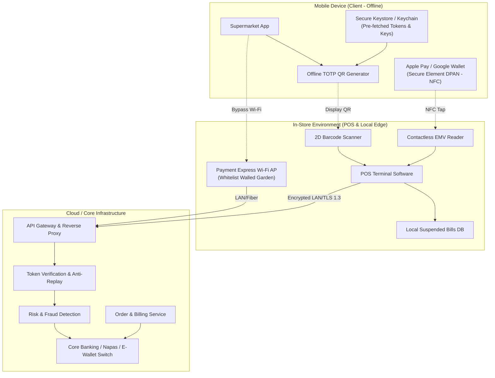
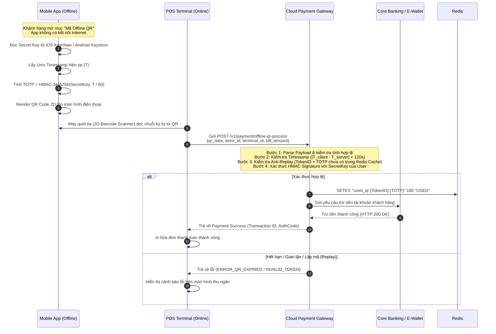
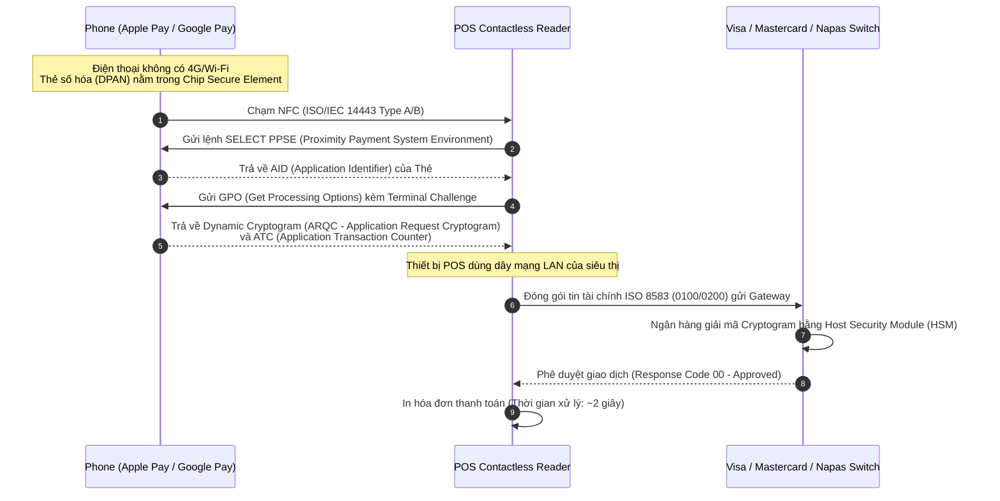

# ĐẶC TẢ YÊU CẦU PHẦN MỀM (SRS)
## SOFTWARE REQUIREMENTS SPECIFICATION (SRS)

**Dự án:** Hệ Thống Thanh Toán Ngoại Tuyến & Quản Lý Giao Dịch Siêu Thị (Supermarket Offline Payment & Resilient Checkout System - SOPRCS)  
**Tiêu chuẩn tài liệu:** Tuân thủ chuẩn IEEE 830 / ISO/IEC/IEEE 29148  
**Phiên bản:** 1.0  
**Tác giả:** System Architect & Lead Software Engineer  
**Ngày phát hành:** 15/09/2026  
**Trạng thái:** Bản thảo kỹ thuật chính thức (Official Draft)  

---

## MỤC LỤC
1. [Giới thiệu (Introduction)](#1-giới-thiệu-introduction)
2. [Mô tả tổng quan hệ thống (Overall Description)](#2-mô-tả-tổng-quan-hệ-thống-overall-description)
3. [Kiến trúc hệ thống & Luồng dữ liệu kỹ thuật (System Architecture & Data Flows)](#3-kiến-trúc-hệ-thống--luồng-dữ-liệu-kỹ-thuật-system-architecture--data-flows)
4. [Đặc tả yêu cầu chức năng (Detailed Functional Requirements)](#4-đặc-tả-yêu-cầu-chức-năng-detailed-functional-requirements)
5. [Yêu cầu giao diện ngoại vi (External Interface Requirements)](#5-yêu-cầu-giao-diện-ngoại-vi-external-interface-requirements)
6. [Yêu cầu phi chức năng (Non-Functional Requirements - NFRs)](#6-yêu-cầu-phi-chức-năng-non-functional-requirements---nfrs)
7. [Mô hình dữ liệu kỹ thuật (Data Models & Schemas)](#7-mô-hình-dữ-liệu-kỹ-thuật-data-models--schemas)
8. [Tiêu chí kiểm thử và nghiệm thu (Verification & Acceptance Criteria)](#8-tiêu-chí-kiểm-thử-và-nghiệm-thu-verification--acceptance-criteria)

---

## 1. Giới thiệu (Introduction)

### 1.1. Mục đích (Purpose)
Tài liệu này đặc tả toàn bộ các yêu cầu chức năng, yêu cầu phi chức năng, kiến trúc kỹ thuật và giao thức bảo mật cho giải pháp **"Supermarket Offline Payment & Resilient Checkout System" (SOPRCS)**. Hệ thống này giải quyết dứt điểm sự cố khách hàng không mang ví tiền/thẻ vật lý và điện thoại mất kết nối mạng (không có 4G/5G/Wi-Fi) tại các điểm bán của siêu thị.

### 1.2. Quy ước tài liệu (Document Conventions)
- Các yêu cầu được đánh mã định danh duy nhất theo cú pháp: `[Mã Module]-[STT]`.
- Mức độ ưu tiên theo chuẩn MoSCoW:
  - **MUST (Bắt buộc):** Chức năng cốt lõi bắt buộc phải có trong phiên bản phát hành đầu tiên.
  - **SHOULD (Khuyến nghị):** Chức năng quan trọng, ưu tiên cao.
  - **COULD (Có thể):** Chức năng mở rộng, có thể triển khai sau.
  - **WON'T (Chưa làm):** Không nằm trong lộ trình hiện tại.

### 1.3. Đối tượng sử dụng (Intended Audience)
- **Software Engineers / Backend / Frontend / Mobile Developers:** Căn cứ triển khai API, mã hóa Token, xây dựng UI/UX.
- **Network & DevOps Engineers:** Cấu hình hệ thống Access Point Wi-Fi 6, cấu hình Firewall Walled Garden, triển khai Edge Service.
- **QA/QC Engineers:** Căn cứ lập Test Plan, Test Case và kiểm thử tải/bảo mật.
- **Project Manager & Scrum Master:** Quản lý phạm vi và phân bổ sprint.

---

## 2. Mô tả tổng quan hệ thống (Overall Description)

### 2.1. Bối cảnh sản phẩm (Product Perspective)
Hệ thống SOPRCS hoạt động tại điểm giao thoa giữa 4 phân hệ chính:
1. **Client Application (Mobile App):** Ứng dụng di động của siêu thị tích hợp module sinh mã QR ngoại tuyến (Offline TOTP Engine) và bộ đệm token mã hóa (Local Keystore).
2. **In-Store POS System (Edge Layer):** Máy bán hàng tại siêu thị, tích hợp máy quét mã vạch 2D (Barcode/QR Scanner), đầu đọc NFC Contactless EMV và module treo đơn (Cart Parking Engine).
3. **In-Store Payment Wi-Fi Gateway:** Hệ thống mạng không dây cục bộ có chức năng định tuyến lưu lượng, bypass Captive Portal và giới hạn Whitelist các domain tài chính.
4. **Cloud Payment Gateway & Anti-Fraud Engine:** Cổng thanh toán trung tâm xác thực mã token offline, kiểm tra chống tấn công lặp lại (Replay Attack) và kết nối trừ tiền Core Banking/E-Wallet.



### 2.2. Đặc tính người dùng (User Classes & Characteristics)
- **Khách hàng (Shopper):** Mọi lứa tuổi, không cần hiểu biết kỹ thuật; thao tác mở mã QR hoặc chạm NFC phải diễn ra tức thì trong 1 chạm.
- **Thu ngân (Cashier):** Nhân viên thao tác máy POS, cần phím tắt nhanh, giao diện thông báo lỗi trực quan (màu sắc rõ ràng) và kịch bản gợi ý hành động cụ thể trên màn hình.
- **Quản trị viên hạ tầng (IT Admin):** Giám sát lưu lượng Wi-Fi, trạng thái kết nối POS và sức khỏe của các luồng thanh toán.

### 2.3. Môi trường vận hành (Operating Environment)
- **POS Terminal:** Windows 10/11 IoT Enterprise, RAM >= 8GB, kết nối cáp LAN Gigabit Ethernet dự phòng 2 đường truyền (Dual-WAN).
- **Mobile Client:** iOS 14+ (hỗ trợ Secure Enclave, CryptoKit) và Android 8.0+ (hỗ trợ Android Keystore, API level 26+).
- **Wi-Fi Infrastructure:** Thiết bị phát sóng Access Point chuẩn Wi-Fi 6 (802.11ax), hỗ trợ Band Steering, VLAN tagging, Radius/Firewall routing.

---

## 3. Kiến trúc hệ thống & Luồng dữ liệu kỹ thuật (System Architecture & Data Flows)

### 3.1. Thuật toán sinh mã QR Ngoại Tuyến (Offline Dynamic QR Engine)

Mã QR ngoại tuyến được mã hóa dưới dạng chuỗi Base64URL với cấu trúc payload bảo mật cao:

$$\text{Payload} = \text{Base64URL}(\text{Version} \parallel \text{UserID} \parallel \text{TokenID} \parallel \text{Timestamp} \parallel \text{TOTP} \parallel \text{Signature})$$

Trong đó:
- **Version (1 byte):** Phiên bản cấu trúc mã (ví dụ: `0x01`).
- **UserID (8 bytes):** Mã định danh khách hàng trên hệ thống.
- **TokenID (16 bytes):** UUID duy nhất của Token được cấp phát trước đó (Pre-shared Token).
- **Timestamp (4 bytes):** Thời gian Unix Epoch (giây) tại thời điểm thiết bị sinh mã.
- **TOTP (4 bytes):** Giá trị mã OTP dựa trên thời gian, sinh bởi thuật toán HMAC-SHA256 kết hợp khóa bí mật thiết bị ($K_{dev}$) và bước nhảy thời gian $\Delta t = 60$ giây.
- **Signature (32 bytes):** Chữ ký số HMAC-SHA256 của toàn bộ payload trên, sử dụng khóa Session Key lưu trong Secure Enclave.



### 3.2. Cơ chế NFC Contactless (Apple Pay / Google Wallet) Ngoại Tuyến



---

## 4. Đặc tả yêu cầu chức năng (Detailed Functional Requirements)

### 4.1. Module 1: Xử lý Token & Sinh mã QR trên Mobile Client (FR-MOB)

| Mã Yêu Cầu | Tên chức năng | Mô tả chi tiết | Mức ưu tiên |
|---|---|---|:---:|
| **FR-MOB-01** | Tự động tải trước Token (Pre-fetch Token Engine) | Khi điện thoại có kết nối Internet (mỗi khi mở app hoặc chạy ngầm), ứng dụng phải tự động đồng bộ và tải trước một túi gồm **5 Token ngoại tuyến** từ Cloud API. Token được lưu trữ an toàn trong phần cứng bảo mật (iOS Keychain / Android Keystore). | **MUST** |
| **FR-MOB-02** | Nhận diện trạng thái mạng (Network Resilience Detection) | Hệ thống tự động lắng nghe sự kiện mạng (`NetworkConnectivityChanged`). Nếu `isOnline == false`, giao diện thanh toán tự động chuyển sang tab "Thanh toán ngoại tuyến (Offline Mode)" mà không hiển thị lỗi kết nối. | **MUST** |
| **FR-MOB-03** | Sinh mã QR động ngoại tuyến (Offline TOTP Generation) | Khi người dùng xác thực vân tay/FaceID, app giải mã Secret Key cục bộ và sinh mã QR TOTP với chu kỳ đổi mã mỗi 60 giây. Thanh đếm ngược hiển thị vòng tròn thời gian còn lại trực quan. | **MUST** |
| **FR-MOB-04** | Tự động tăng độ sáng màn hình | Khi hiển thị màn hình mã QR Offline, ứng dụng tự động tăng độ sáng màn hình lên mức 100% để máy quét mã vạch của POS đọc chuẩn xác trong điều kiện ánh sáng quầy. | **SHOULD** |
| **FR-MOB-05** | Đồng bộ trạng thái sau khi online (Post-Sync) | Ngay khi điện thoại có kết nối Internet trở lại, app lập tức gửi sự kiện đồng bộ để thu hồi các token đã dùng, cập nhật biến động số dư và tải gói token mới. | **MUST** |

### 4.2. Module 2: Xử lý tại Máy POS và Thiết bị ngoại vi (FR-POS)

| Mã Yêu Cầu | Tên chức năng | Mô tả chi tiết | Mức ưu tiên |
|---|---|---|:---:|
| **FR-POS-01** | Hỗ trợ quét mã QR 2D đa định dạng | Đầu đọc mã vạch tại quầy phải đọc được mã QR chứa chuỗi ký tự Base64 dài tới 256 ký tự trong thời gian dưới 500ms. | **MUST** |
| **FR-POS-02** | Xử lý giao dịch NFC Contactless | Ứng dụng POS kết nối với máy quẹt thẻ PIN-pad qua cổng USB/RS232, hỗ trợ chuẩn EMV Contactless Level 1 & Level 2 (Visa payWave, Mastercard Contactless, Napas Contactless). | **MUST** |
| **FR-POS-03** | Tính năng Treo đơn hàng (Suspend / Park Order) | Thu ngân có thể bấm phím nóng `[F8]` để tạm lưu đơn hàng hiện tại. Hệ thống lưu toàn bộ danh mục sản phẩm, số lượng, giảm giá vào DB nội bộ và in ra một phiếu "Phiếu giữ giỏ hàng" chứa mã vạch `HOLD-YYYYMMDD-XXXX`. Quầy thu ngân lập tức mở giỏ hàng trống cho khách kế tiếp. | **MUST** |
| **FR-POS-04** | Tính năng Khôi phục đơn hàng (Resume Parked Order) | Thu ngân dùng máy quét quét mã vạch trên "Phiếu giữ giỏ hàng", POS tự động nạp lại toàn bộ danh mục món hàng cũ lên màn hình thanh toán trong vòng 1 giây. | **MUST** |
| **FR-POS-05** | Tự động hủy đơn treo quá hạn | Các đơn hàng treo quá 60 phút mà không có khách quay lại thanh toán sẽ tự động chuyển sang trạng thái `AUTO_CANCELLED`, gửi thông báo đến nhân viên quản lý kho kệ để thu hồi hàng tươi sống. | **SHOULD** |

### 4.3. Module 3: Cổng thanh toán & Chống gian lận (FR-GW)

| Mã Yêu Cầu | Tên chức năng | Mô tả chi tiết | Mức ưu tiên |
|---|---|---|:---:|
| **FR-GW-01** | Xác thực Token & Chữ ký số | Cổng thanh toán tiếp nhận payload mã QR từ POS, đối chiếu chữ ký số HMAC-SHA256 với User Secret Key được mã hóa trong cơ sở dữ liệu phân tán. | **MUST** |
| **FR-GW-02** | Cơ chế chống tấn công lặp lại (Anti-Replay Protection) | Cổng thanh toán duy trì một bộ nhớ đệm Redis lưu trữ cặp khóa `{UserID}:{TokenID}:{TOTP}` với TTL = 180 giây. Nếu mã đã tồn tại trong bộ nhớ đệm, giao dịch bị từ chối ngay lập tức với mã lỗi `DUPLICATE_TRANSACTION_REJECTED`. | **MUST** |
| **FR-GW-03** | Khử sai lệch thời gian (Time Drift Window) | Chấp nhận dung sai chênh lệch đồng hồ giữa thiết bị di động của khách hàng và Cloud Server trong khoảng tối đa $\pm 60$ giây (tương đương 1 bước nhảy TOTP). | **MUST** |
| **FR-GW-04** | Hạn mức chi tiêu ngoại tuyến (Offline Spending Limit) | Giới hạn tối đa cho 1 giao dịch Offline QR là 1.000.000 VNĐ. Nếu tổng giá trị đơn hàng vượt quá 1.000.000 VNĐ, hệ thống POS yêu cầu khách hàng chia nhỏ đơn hoặc sử dụng NFC/Wi-Fi Express. | **MUST** |

### 4.4. Module 4: Tạm ứng thanh toán sau cho Hội viên (FR-BNPL)

| Mã Yêu Cầu | Tên chức năng | Mô tả chi tiết | Mức ưu tiên |
|---|---|---|:---:|
| **FR-BNPL-01** | Kiểm tra điều kiện phê duyệt tức thì (Instant In-Store Credit Check) | Khi khách hàng nhập mã Hội viên/Số điện thoại, POS gọi microservice kiểm tra: (1) Hội viên đã eKYC, (2) Điểm tín nhiệm nội bộ >= 650, (3) Không có nợ xấu quá hạn. Thời gian phản hồi < 800ms. | **SHOULD** |
| **FR-BNPL-02** | Cấp quyền xuất hóa đơn nợ (Pay Later Authorization) | Nếu đủ điều kiện, POS in hóa đơn mua hàng ghi nhận phương thức "Tạm ứng Siêu thị (Trust Pay Later)". Hạn mức tối đa 500.000 VNĐ. | **SHOULD** |
| **FR-BNPL-03** | Tự động hóa nhắc nợ đa kênh | Ngay khi giao dịch tạm ứng được tạo, hệ thống lên lịch gửi thông báo nhắc nợ qua App Push Notification, Zalo ZNS và SMS chứa liên kết thanh toán VNPAY/VietQR. Tự động khóa thẻ tích điểm nếu quá hạn 24 giờ. | **SHOULD** |

### 4.5. Module 5: Hạ tầng Mạng Wi-Fi Thanh toán Cấp tốc (FR-NET)

| Mã Yêu Cầu | Tên chức năng | Mô tả chi tiết | Mức ưu tiên |
|---|---|---|:---:|
| **FR-NET-01** | Cấu hình Walled Garden Firewall | Thiết lập Access Controller chỉ cho phép phân giải DNS và lưu lượng IP tới dải danh sách trắng: Domain Napas, VNPAY, MoMo, ZaloPay, VietQR, App Siêu thị, và các IP dải Core Banking được phê duyệt. | **MUST** |
| **FR-NET-02** | Zero-Config Onboarding via QR | Hệ thống phát SSID ẩn hoặc hiển thị với tên `@SieuThi_ThanhToanNhanh`. Khách hàng quét mã QR chuẩn Wi-Fi đặt tại quầy để tự động cấu hình mạng trên iOS (CoreWiFi framework) và Android (WifiNetworkSpecifier) không cần hỏi mật khẩu. | **MUST** |
| **FR-NET-03** | QoS & Session Throttling | Giới hạn băng thông mỗi thiết bị: Download 2 Mbps, Upload 1 Mbps (vừa đủ tải giao dịch tài chính, không đủ stream video HD). Tự động ngắt kết nối sau 15 phút. | **MUST** |

---

## 5. Yêu cầu giao diện ngoại vi (External Interface Requirements)

### 5.1. Giao diện người dùng (UI Requirements)

#### Màn hình Thu ngân (POS Cashier Interface)
- Bổ sung thanh trạng thái phương thức thanh toán nhanh:
  - `[F7]` : Quét mã Offline QR.
  - `[F8]` : Treo đơn hàng (Park Cart).
  - `[F9]` : Khôi phục đơn treo (Resume Cart).
  - `[F10]`: Tạm ứng Hội viên (Pay Later).
- Khi có lỗi mất mạng từ phía khách, hiển thị hộp thoại gợi ý hành động gồm 3 nút lớn:
  1. *"Hướng dẫn khách chạm Apple/Google Pay"* (Phím 1)
  2. *"Hướng dẫn quét mã Wi-Fi thanh toán tại quầy"* (Phím 2)
  3. *"Treo đơn hàng in phiếu giữ chỗ"* (Phím 3)

#### Màn hình App Di động (Mobile App Interface)
- Widget nổi bật tại trang chủ khi mất mạng: *"Mã thanh toán không cần mạng (Offline Pay)"*.
- Màn hình hiển thị mã QR: Kèm đồng hồ đếm ngược 60s, hướng dẫn ngắn *"Đưa mã này cho thu ngân quét"*.

### 5.2. Giao diện phần cứng (Hardware Interfaces)
- **Đầu đọc mã vạch 2D:** Kết nối chuẩn USB HID Keyboard Emulation hoặc Virtual COM Port (RS232). Tốc độ baud 115200 bps.
- **Thiết bị thanh toán thẻ (PIN-Pad):** Kết nối qua cổng TCP/IP nội bộ hoặc USB, hỗ trợ chuẩn truyền thông liên ngân hàng EMV Contactless ISO/IEC 14443 Type A & B.

### 5.3. Giao diện phần mềm & API (Software Interfaces)

#### API 1: Xử lý giao dịch Offline QR
- **Endpoint:** `POST /api/v1/checkout/offline-qr`
- **Headers:** 
  - `Authorization: Bearer <POS_EDGE_JWT>`
  - `X-Store-Id: STR_001`
  - `X-Terminal-Id: POS_LINE_03`
- **Request Body:**
```json
{
  "qr_payload": "AQE4MTkyMzEwYTFlYjkyODBhNmRjYzM4MTQxMjA...",
  "cart_id": "CART_9921827",
  "amount": 450000,
  "currency": "VND",
  "cashier_id": "EMP_1024",
  "timestamp": 1726372800
}
```
- **Response Success (200 OK):**
```json
{
  "status": "SUCCESS",
  "transaction_id": "TX_20260915_88192301",
  "auth_code": "AUTH_992014",
  "processed_at": "2026-09-15T11:45:00Z",
  "customer_masked_name": "NGUYEN VAN *",
  "payment_method": "SUPERMARKET_OFFLINE_WALLET",
  "deducted_amount": 450000,
  "remaining_balance": 1550000
}
```

---

## 6. Yêu cầu phi chức năng (Non-Functional Requirements - NFRs)

### 6.1. Hiệu năng (Performance Requirements)
- **NFR-PERF-01 (Thời gian phản hồi giao dịch):** Thời gian tính từ khi máy quét đọc mã QR đến khi POS in hóa đơn thành công phải **<= 1.5 giây** trong điều kiện mạng nội bộ bình thường.
- **NFR-PERF-02 (Thời gian sinh mã QR trên di động):** Quá trình sinh mã QR ngoại tuyến trên điện thoại phải hoàn tất trong **<= 300 miligiây** từ lúc mở tính năng.
- **NFR-PERF-03 (Khả năng chịu tải đồng thời):** Cổng thanh toán Cloud phải chịu tải tối thiểu **2.000 giao dịch/giây (TPS)** trên toàn hệ thống chuỗi siêu thị vào giờ cao điểm lễ, tết.

### 6.2. An toàn & Bảo mật (Security Requirements)
- **NFR-SEC-01 (Tiêu chuẩn PCI-DSS):** Toàn bộ đường truyền dữ liệu tài chính giữa POS và Gateway phải mã hóa bằng giao thức **TLS 1.3**. Dữ liệu thẻ và token tuân thủ nghiêm ngặt tiêu chuẩn PCI-DSS 4.0.
- **NFR-SEC-02 (Bảo vệ phần cứng thiết bị di động):** Khóa bí mật (Secret Key) dùng để sinh TOTP phải được lưu trữ trong **Secure Enclave** (đối với iOS) hoặc **Hardware-backed Keymaster / StrongBox** (đối với Android). Tuyệt đối không lưu plaintext trong SharedPreferences hoặc SQLite.
- **NFR-SEC-03 (Chống giả mạo dữ liệu - Data Integrity):** Mã QR Offline phải có chữ ký HMAC-SHA256 đi kèm. Nếu phát hiện payload bị chỉnh sửa dù chỉ 1 bit, giao dịch lập tức bị hủy bỏ.
- **NFR-SEC-04 (Bảo mật mạng Wi-Fi thanh toán):** Mạng Wi-Fi thanh toán áp dụng cách ly máy khách (Client Isolation / AP Isolation) để các thiết bị của khách hàng kết nối vào không thể nhìn thấy hoặc quét gói tin của nhau.

### 6.3. Độ tin cậy & Tính sẵn sàng (Reliability & Availability)
- **NFR-REL-01 (Tính sẵn sàng của hệ thống):** Cổng thanh toán trung tâm cam kết SLA đạt tối thiểu **99.99% Up-time**.
- **NFR-REL-02 (Dự phòng mạng POS - Dual Connectivity):** Mỗi quầy POS phải có 2 kết nối mạng: Cáp mạng LAN chính (Primary Fiber) và USB 4G Dongle công nghiệp tự động chuyển mạch (Failover) trong vòng 2 giây nếu đứt cáp quang.

---

## 7. Mô hình dữ liệu kỹ thuật (Data Models & Schemas)

### 7.1. Bảng lưu trữ Token Ngoại Tuyến (OfflineTokens Table)
```sql
CREATE TABLE offline_payment_tokens (
    token_id VARCHAR(36) PRIMARY KEY,
    user_id VARCHAR(32) NOT NULL,
    device_fingerprint VARCHAR(64) NOT NULL,
    encrypted_secret_key TEXT NOT NULL,
    max_single_limit DECIMAL(12, 2) DEFAULT 1000000.00,
    max_accumulated_limit DECIMAL(12, 2) DEFAULT 3000000.00,
    used_amount DECIMAL(12, 2) DEFAULT 0.00,
    is_active BOOLEAN DEFAULT TRUE,
    issued_at TIMESTAMP WITH TIME ZONE DEFAULT CURRENT_TIMESTAMP,
    expires_at TIMESTAMP WITH TIME ZONE NOT NULL,
    last_synced_at TIMESTAMP WITH TIME ZONE
);
CREATE INDEX idx_offline_user ON offline_payment_tokens(user_id, is_active);
```

### 7.2. Bảng quản lý Đơn hàng treo (ParkedOrders Table)
```sql
CREATE TABLE parked_orders (
    park_id VARCHAR(32) PRIMARY KEY,          -- Mã vạch in ra: HOLD-20260915-0012
    store_id VARCHAR(16) NOT NULL,
    terminal_id VARCHAR(16) NOT NULL,
    cashier_id VARCHAR(16) NOT NULL,
    customer_id VARCHAR(32),                   -- Có thể rỗng nếu khách vãng lai
    total_amount DECIMAL(12, 2) NOT NULL,
    order_items_json JSONB NOT NULL,          -- Danh mục sản phẩm, mã vạch, số lượng, giá
    status VARCHAR(20) DEFAULT 'SUSPENDED',   -- 'SUSPENDED', 'RESUMED', 'EXPIRED', 'CANCELLED'
    created_at TIMESTAMP WITH TIME ZONE DEFAULT CURRENT_TIMESTAMP,
    expires_at TIMESTAMP WITH TIME ZONE NOT NULL
);
CREATE INDEX idx_park_barcode ON parked_orders(park_id, status);
```

### 7.3. Bảng phòng chống tấn công lặp lại (NonceReplayCache Schema)
- **Engine:** In-Memory Redis Cluster
- **Key pattern:** `anti_replay:{user_id}:{token_id}:{totp_code}`
- **Value:** `{"pos_id": "POS_LINE_03", "processed_at": 1726372800, "status": "CONSUMED"}`
- **TTL:** 180 seconds

---

## 8. Tiêu chí kiểm thử và nghiệm thu (Verification & Acceptance Criteria)

| Kịch bản kiểm thử (Test Case) | Điều kiện tiên quyết | Các bước thực hiện | Kết quả kỳ vọng (Expected Result) |
|---|---|---|---|
| **TC-01: Thanh toán Apple/Google Pay không mạng** | Điện thoại bật chế độ máy bay (Airplane Mode: tắt Wi-Fi, 4G, Bluetooth). | 1. Quét sản phẩm trên POS.<br/>2. Thu ngân chọn thanh toán Thẻ/NFC.<br/>3. Khách chạm iPhone vào đầu đọc thẻ. | Giao dịch báo thành công trong vòng <= 3 giây; POS in hóa đơn đầy đủ. |
| **TC-02: Thanh toán Offline QR trên App** | Điện thoại tắt toàn bộ mạng; đã tải trước Token. | 1. Mở App Siêu thị, chọn 'Mã Offline'.<br/>2. Quét mã bằng máy quét 2D tại quầy.<br/>3. POS gửi request xác thực lên Gateway. | Giao dịch trừ tiền ví/thẻ liên kết thành công; màn hình POS đổi trạng thái 'Đã thanh toán'. |
| **TC-03: Chống Replay Attack** | Đã thực hiện TC-02 thành công. | Dùng máy quét quét lại chính mã QR vừa dùng trong vòng 30 giây tiếp theo. | Hệ thống POS báo lỗi: `Giao dịch trùng lặp / Mã QR đã sử dụng`, từ chối trừ tiền lần 2. |
| **TC-04: Treo và khôi phục đơn hàng** | Khách chưa thanh toán được ngay. | 1. Thu ngân bấm `F8` treo đơn, in phiếu giữ chỗ.<br/>2. Thanh toán đơn cho khách sau.<br/>3. Quét phiếu giữ chỗ để khôi phục. | Đơn hàng cũ khôi phục nguyên vẹn 100% món và số tiền trong < 1.5 giây; đơn mới của khách sau thanh toán trôi chảy. |
| **TC-05: Quét mã QR kết nối Express Wi-Fi** | Điện thoại Android/iOS mất mạng. | Mở Camera quét mã QR Wi-Fi dán tại quầy. | Thiết bị tự động kết nối Wi-Fi không hỏi mật khẩu trong 2 giây; mở được app ngân hàng chuyển khoản; không thể mở YouTube/TikTok. |

---
*Tài liệu này là tài sản kỹ thuật chính thức làm cơ sở bàn giao cho đội ngũ Phát triển & Vận hành dự án.*

